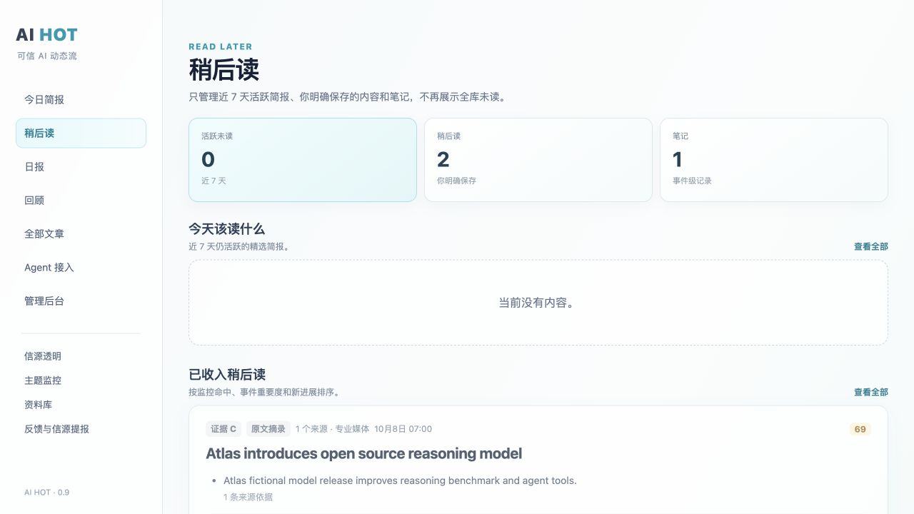

# 独立离线验收记录 · 2026-10-08

结论：本地单用户工程闭环通过。尚不代表真实采集、模型或用户价值验收。以下本机记录来自冻结技术候选；公开 Alpha 只更新 MIT 许可与发布文案，最终提交的 Linux CI 和实际 Release 下载复验结果另附 Release 资产。

## 隔离与保护证据

- 原目录只做只读源码/Git/运行文件元数据核对；不执行启动、建库、迁移、备份或恢复。27 个源码文件（22 个原跟踪文件 + 5 个未跟踪模块）的 SHA-256 与快照一致；原 Git HEAD 与 13 M / 5 ?? 状态未变。
- 原 SQLite、WAL/SHM 的元数据在验收期间有变化，原目录仍有既存服务运行；本轮未停止该服务，也未对其执行任何启动、恢复或迁移操作。其他已盘点文件的大小和 mtime 未变。此处不声称真实数据库字节冻结。未读取或打印真实令牌；未复制真实运行数据。
- 工作区之外保存私有源码 tar 快照、原 Git bundle、完整二进制差异、文件白名单与哈希清单。可在另一个空目录恢复脏源码。私有恢复资料不属于可分发候选。
- 独立候选通过文件白名单构建。运行时再从候选白名单创建 `.alpha-runs/run-*/app`，data 仅干净 sources.json（138 个全部停用）及空 editorial-overrides.json。初始无 SQLite、令牌、日志、备份、旧 JSON、.env.local 或 symlink。
- 清除继承的所有凭证、DATABASE_PATH、NODE_OPTIONS 等；只留测试所需的 PATH/TZ/TMPDIR/PORT/本地端口白名单。原路径未出现在候选进程的配置中。
- 所有启动及恢复（包括恢复回归子进程）在候选副本目录内。测试临时目录也在候选内。不是仅关闭调度或覆盖数据库路径：调度保持开启，启动补跑与维护均实际运行。

## 验收环境与结果

Node.js **v24.14.0**，macOS，本机内建 SQLite，无 npm 依赖安装。固定应用时间 **2026-10-08T00:06:00.000Z / 上海 08:06**；虚构 Feed 发布时间上海 07:00。Fetch 与底层 Socket.connect 只允许本次指定的 127.0.0.1 端口，非本地网络探测被拦截。这是进程守卫，无操作系统级断网声明。

执行 `npm run verify:offline` / `npm run demo:offline`。以下全部通过：

| 环节 | 实际断言与结果 |
| --- | --- |
| 单元测试 | 原 39 项 + 3 项恢复回归，共 42 项，固定时间与网络守卫下全部通过 |
| 首次启动 | 全新 SQLite、0 文章、0 简报；自动生成候选令牌权限 0600；模型 configured=false；调度开启，等启动补跑与维护完成，0 采集请求 |
| Web/API 安全边界 | 首页/JS/CSS/OpenAPI/Agent Skill 均 200；无令牌 admin 请求 401；跨源阅读/监控写入 403 |
| OPML 与采集 | API 导入本地自制 Feed；停用/启用持久配置；首次采集 inserted=3，重试 ETag 返回 304，无重复插入 |
| 无模型简报 | 3 条文章得到 3 条事件简报；fallback/degraded，whyItMatters=null；每条 claim 的 sourceItemIds 对应存在的来源 |
| 阅读 | GET 详情不自动已读；显式 read/save/note/hide/unhide；阅读台、周回顾、旧文章级稍后状态均正确 |
| 监控器 | 创建 Atlas 关键词监控，priority=3；增加排除词后命中为 0；去掉排除词恢复 3 |
| 日报/RSS | 固定日期冻结，精选 1 条，质量 degraded；briefs/all/selected/daily 四个 RSS 200 且非空，可由 Feed parser 解析 |
| 重启 | 停候选后重启同一副本；文章级及简报级阅读状态、笔记、监控器、优先级、日报快照保持 |
| 备份与恢复 | API 生成 SQLite 备份，随后修改笔记并删除监控器；停服务，在该候选中运行 CLI restore；重启后原笔记、read/save、监控器、文章状态及日报恢复；CLI backup 成功，PRAGMA quick_check=ok |
| 浏览器人工核对 | 在候选本地端口打开首页、简报详情；点“看完”变“重新阅读”，点“稍后读”后阅读台有 2 条保存内容；主题监控页显示 Atlas Alpha；浏览器 error/warn 记录为空 |
| 源码验证 | 18 个 JS/MJS 文件语法检查通过；OpenAPI YAML 可由 Ruby 标准 YAML 解析 |

机器可读结果：[offline-result.json](offline-result.json)。单元记录：[UNIT-TESTS.txt](UNIT-TESTS.txt)。恢复记录：[RESTORE-CHECK.txt](RESTORE-CHECK.txt)。完整性记录：[SQLITE-INTEGRITY.txt](SQLITE-INTEGRITY.txt)。网页证据：

## 实际失败与范围内修复

1. **恢复接受损坏文件**：原 CLI 对名字符合规则的非 SQLite 文件返回 0 并覆盖当前库。新增回归测试先复现失败；现先只读 quick_check，失败不改变当前数据库。
2. **恢复接受 symlink**：原 CLI 使用 stat/copyFile，会沿符号链接复制外部文件。新增回归先复现失败；现拒绝备份文件和备份目录符号链接，要求路径位于该候选 backups。
3. **恢复接受其他应用 SQLite**：原 CLI 未核对内容。新增回归先复现失败；现至少核对 items/issues/source_state 核心表。有效快照先 staging，经安全副本后原子 rename；正常完整恢复闭环通过。
4. **测试预期错误**：首次端到端将 3 篇虚构文章误断言为 3 条精选日报。现根据真实规则生成的 selected 计数验收（本样例为 1），未修改产品评分或强制虚构文章精选。

候选另外仅增加离线验收/演示脚本、虚构样例、交付文档和恢复回归，修改初始信源配置、包版本/引擎信息与 CI 验收入口；产品功能冻结。五个新增产品模块和现有前端业务逻辑保持原工作区内容。

## 交付边界

正式发布提交见 Release 资产中的 RELEASE-COMMIT.txt；源码包从同一提交 git archive 导出，文件哈希见 SOURCE-MANIFEST.sha256。正式 LICENSE 和许可文案更新不改变本记录所验证的产品代码。最终提交的 GitHub CI 及公开资产实际下载复验另附于 [Alpha Release](https://github.com/Sealdot/ai-hot/releases/tag/v0.9.0-alpha.1)。

维护者已确认 MIT、署名、完整源码和样例公开权利并授权首次公开 Alpha。原私有历史和恢复材料不推送；无 npm 发布、持久服务安装或外部人员联系。已知限制见 [KNOWN-LIMITATIONS.md](KNOWN-LIMITATIONS.md)。
